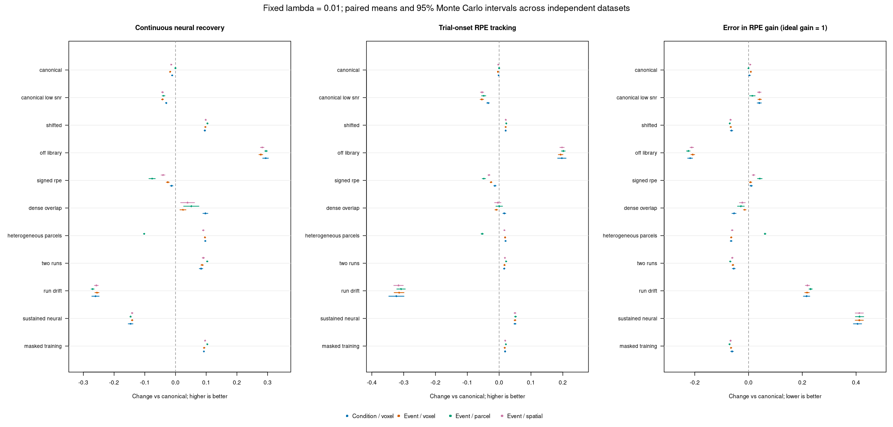
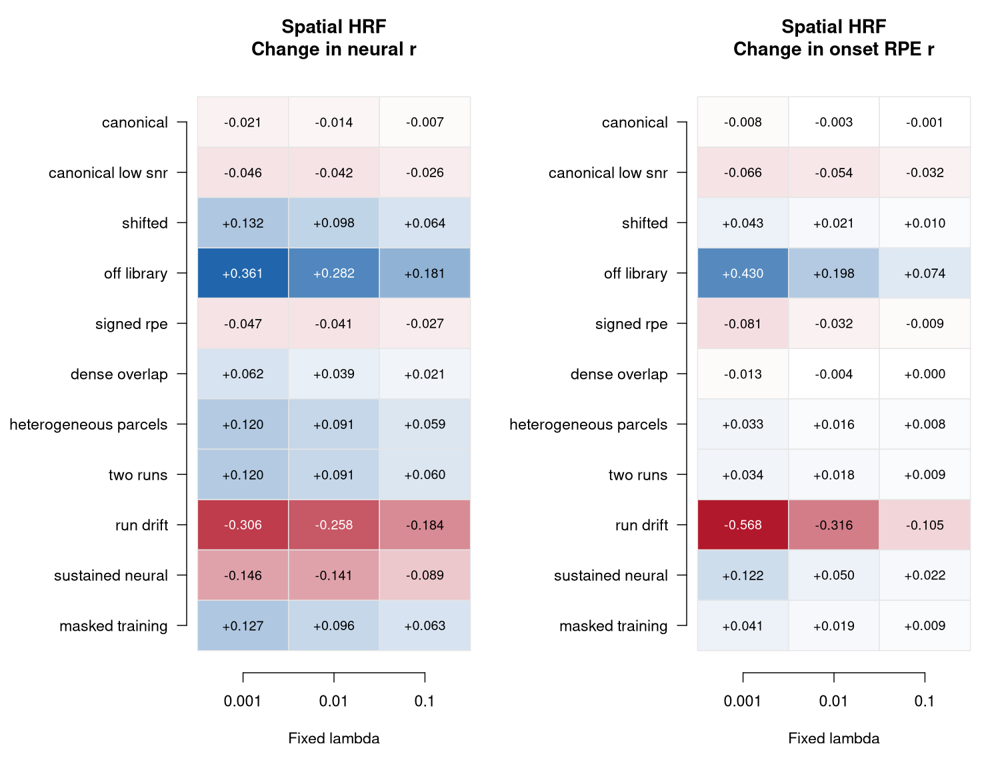

# Does estimating the HRF improve neural recovery?

This report evaluates the HRF-estimation interface introduced in PR #45. Its
question is whether learning HRF shapes from other runs improves recovery of
known neural activity relative to assuming the canonical shape. The earlier
single-seed review example is a demonstration; the repeated validation below is
the stronger comparison. These are simulation results, not participant-data
validation.

This report retains the original OLS/heuristic settings. The script now requests
`noise_model = "ols", evidence = "legacy"` explicitly to preserve that comparison
after defaults change. See [NOISE_AWARE_HRF_RECOVERY.md](NOISE_AWARE_HRF_RECOVERY.md)
for the new covariance/evidence workflow and its independent validation.

**The numerical implementation passes its checks, but HRF learning is not a
general improvement.** In 480 simulated datasets it helped when a stable HRF
differed from the canonical shape. It harmed recovery when the canonical HRF was
correct, SNR was low, or HRFs changed between runs. Most relevant to the intended
RPE use: the noisy zero-mean signed-response case did not benefit from free-event
fitting, even though the noiseless unit test showed that such fitting can identify
an HRF in principle. I would retain canonical recovery as the baseline and keep
HRF estimation opt-in while improving noise-aware evidence and validation.

## Experiment fixed before the repeated run

Each scenario has 40 independently generated multirun datasets. Each dataset has
24 voxels in two supplied parcels, 220 observations per run, and TR = 1 second.
There are three runs except the two-run and changing-HRF scenarios. Voxels have
different signed gains; three quarters are positive and one quarter negative.
Neural feedback responses vary with a standardized, autocorrelated RPE sequence.
Cue/response amplitudes also vary across trials. Cue, response, and feedback times
vary within trials. The HRF fitter receives event times/types, never RPE values or
the generating neural activity.

The default stationary noise SD is 0.04, with temporal AR(1) coefficient 0.5 and
a shared noise component across voxels. The low-SNR control uses SD 0.15.
Noise, event schedules, RPE sequences, gains, and trial amplitudes vary across
replications. Baseline BOLD is 100 and is removed by measured-run centering before
the inverse; no target nuisance regressors or artifacts are added/removed here.
Training additionally fits its usual intercept and linear trend.

| Scenario | Generating assumption tested |
| --- | --- |
| canonical | The canonical HRF is already correct. |
| canonical low SNR | The canonical HRF is correct but training evidence is noisy. |
| shifted | Stable, parcel-specific response-delay parameters 5 and 7 seconds. |
| off library | Delay parameters 4.3/8.3, dispersion 1.35/0.9, undershoot ratio 8. |
| signed RPE | Feedback averages to zero; cue/response activity is zero. |
| dense overlap | Feedback intervals are 4--6 rather than 9--13 seconds. |
| heterogeneous parcels | A quarter of each parcel has the other territory's HRF. |
| two runs | Only one other run supplies HRF evidence. |
| run drift | Two runs have delay parameters 4.5 and 7.5; transfer is misspecified. |
| sustained neural | The true HRF is canonical, but feedback neural activity lasts 2.5 seconds; the event model assumes impulses. |
| masked training | Randomly omit 20% of acquisitions from HRF training, retaining their original times. |
| null | Pure noise with unrelated RPE values and no neural task activity. |

The library contains nine SPM-family candidates with response-delay parameters
5/6/7, response dispersions 0.8/1/1.2, and undershoot ratio 6. Delay parameters are
the gamma-model parameters, not an assertion that the sampled peak occurs at
exactly that delay. All shapes have 32-second support and unit signed sum.

The six comparisons are:

- **Canonical:** fixed canonical HRF, with no HRF fitting.
- **Oracle HRF:** the sampled true generating vascular HRF. This is a reference,
  not a guaranteed performance bound when sampling and regularization differ
  from the continuous generator.
- **Condition / voxel:** HRF estimation with one training amplitude per condition,
  independently per voxel and with prespecified canonical fallback.
- **Event / voxel:** a free training amplitude per event record, independently
  per voxel and with prespecified canonical fallback.
- **Event / parcel:** free event amplitudes with one shared HRF per parcel.
- **Event / spatial:** free event amplitudes with voxel HRF selections penalized
  for departing from a training-derived parcel HRF; strength = 0.02.

The target run is excluded from HRF selection and parcel/fallback evidence.
The usual support gates are fixed at adjusted partial R-squared 0.01, one usable
other run, and five parcel voxels. No spatial strength, threshold, candidate,
normalization, or inverse parameter is selected using recovery/RPE results.

All methods use the same quadratic second-difference inverse, numerical ridge
1e-8, measured-run demeaning, no appended zero observations, and fixed lambda.
The primary comparison is lambda = 0.01, matching the prior review example.
Values 0.001 and 0.1 are reported as sensitivity analyses, without selecting a
winning lambda separately for a method or scenario.

## Independent forward model and measurement

Synthetic BOLD uses a continuous, causally truncated difference of gamma
densities evaluated at the exact event-to-acquisition delay. Sustained neural
responses use analytic gamma-CDF integrals. Forward generation does not call
the package's HRF, event-design, or convolution functions. In particular, it does
not first put impulses on the acquisition grid and convolve them with the same
discrete matrix later inverted.

For timecourse scoring, known neural activity is projected onto the TR grid by
linear mass deposition. Sustained neural activity uses 0.025-second quadrature
for this projection. This is a resolution-limited scoring reference, not a claim
of sub-TR recovery. Tests verify that changing this truth projection leaves the
generating BOLD unchanged, and that the analytic generator agrees with independent
quadrature and the intended sampled HRF shapes.

Recovery metrics are calculated for each voxel/run, then averaged within each
independently generated dataset. Paired changes compare each learned method with
canonical recovery on the exact same signals and lambda. The reported 95%
intervals are t intervals over the 40 independent dataset differences. They
describe Monte Carlo precision for these simulations, not population uncertainty
in humans or a multiple-comparison-adjusted hypothesis test.

- **Neural correlation:** correlation of recovered and true acquisition-grid
  activity, omitting 32 seconds at each run edge.
- **Neural NRMSE:** error relative to the true activity's RMS variation after
  separately centering the interior estimates/truth. No gain rescaling is fitted;
  attenuation remains an error. An error of zero is ideal.
- **Onset RPE correlation:** correlation of recovered activity at feedback onset
  with RPE, oriented by the known true voxel sign. Signs are never chosen from
  recovered data. Metrics are voxelwise rather than correlations of a denoised
  parcel average.
- **RPE gain:** recovered RPE regression slope divided by the slope in the known
  grid-projected truth at that same lag. The ideal is one. Gain error is the
  absolute distance from one. This reference accounts for fractional onsets.
- **Window RPE recovery:** analogous correlation/gain for the fixed sum over
  relative lags -1 through +3 seconds, using the same interpolation for all
  methods. Overlap is retained; no truncation is used.
- **Epoch peak error:** discrepancy in the lag with maximum absolute RPE slope
  over -2 through +5 seconds, on a one-second grid.
- **Neighbor leakage:** discrepancy from truth in the previous-trial RPE
  coefficient after controlling for current RPE, normalized by true current gain.
- **HRF error:** normalized squared shape error and absolute sampled peak error.
- **Null behavior:** recovered noise RMS and absolute noise--RPE correlation.
  Neither is a statistical false-positive rate. Neural correlation/NRMSE and
  RPE gain are undefined when there is no true neural variance.

The repeated evaluation reuses inverse matrices across simulated datasets for
speed. It verifies this evaluation against `deconvolve_crossrun_hrf()` on an
actual fitted dataset; the maximum absolute discrepancy was zero. HRF fitting
itself always uses the public estimator and is rerun for every dataset.

## Results

The tables and figures are generated by the scripts below. The primary table
uses the prespecified Event / spatial method and lambda = 0.01; the full tables
retain all six methods and all three lambdas. Interpret both timecourse and
trial-level metrics: better RPE association alone does not establish a correct
neural waveform, vascular HRF, or amplitude scale.

| Scenario | Canonical neural r | Spatial change in neural r | Spatial change in onset RPE r | Spatial change in neural NRMSE |
| --- | ---: | ---: | ---: | ---: |
| canonical | 0.524 | -0.014 [-0.015, -0.012] | -0.003 [-0.004, -0.002] | 0.011 [0.010, 0.012] |
| canonical low snr | 0.255 | -0.042 [-0.046, -0.039] | -0.054 [-0.059, -0.048] | 0.095 [0.090, 0.100] |
| shifted | 0.431 | 0.098 [0.097, 0.100] | 0.021 [0.019, 0.023] | -0.074 [-0.076, -0.072] |
| off library | 0.103 | 0.282 [0.277, 0.288] | 0.198 [0.191, 0.204] | -0.171 [-0.176, -0.167] |
| signed rpe | 0.477 | -0.041 [-0.047, -0.034] | -0.032 [-0.035, -0.029] | 0.073 [0.064, 0.081] |
| dense overlap | 0.420 | 0.039 [0.017, 0.062] | -0.004 [-0.014, 0.006] | -0.023 [-0.037, -0.009] |
| heterogeneous parcels | 0.430 | 0.091 [0.088, 0.093] | 0.016 [0.015, 0.018] | -0.067 [-0.069, -0.064] |
| two runs | 0.429 | 0.091 [0.087, 0.094] | 0.018 [0.016, 0.020] | -0.067 [-0.070, -0.063] |
| run drift | 0.313 | -0.258 [-0.264, -0.252] | -0.316 [-0.331, -0.301] | 0.169 [0.165, 0.173] |
| sustained neural | 0.721 | -0.141 [-0.144, -0.138] | 0.050 [0.047, 0.053] | 0.186 [0.183, 0.189] |
| masked training | 0.431 | 0.096 [0.094, 0.098] | 0.019 [0.018, 0.021] | -0.071 [-0.073, -0.070] |



### What helped

With stable, shifted HRFs, Event / spatial increased continuous neural correlation
from **0.431 to 0.529**, reduced neural NRMSE by **0.074**, and improved onset RPE
correlation from **0.907 to 0.928** (rounded values; see tables). With off-library
HRFs, neural correlation increased from **0.103 to 0.386** and onset RPE
correlation improved by **0.198**. The fixed library could partially accommodate
those shapes, but remained below the true-HRF reference in neural recovery.
Two-run estimation and random training-row masking also retained benefits when
HRFs were stable. These results support transfer across runs under that stability
assumption, not transfer regardless of changes in hemodynamics.

### What failed or remained unresolved

- **Correct canonical / low SNR:** Event / spatial reduced neural correlation by
  0.014 with normal noise and 0.042 with high noise. In the high-noise case, onset
  RPE correlation decreased by 0.054. Learning added estimation error when there
  was little or no true HRF mismatch to correct.
- **Zero-mean signed RPE:** Event / spatial reduced neural correlation by 0.041
  and onset RPE correlation by 0.032. Independent free-event selection and hard
  parcel pooling also harmed recovery. The condition model was less harmful in
  this particular noisy case. The noiseless capability test therefore does not
  justify recommending free-event fitting as a general RPE default.
- **Changing HRFs between runs:** neural correlation fell from 0.313 to 0.055;
  onset RPE correlation decreased by 0.316. Estimating A's HRF from B is harmful
  when B's hemodynamics do not transfer to A.
- **Neural duration absorbed into HRF:** when the actual vascular HRF was
  canonical but neural responses lasted 2.5 seconds, HRF fitting increased onset
  RPE correlation by 0.050 while reducing true neural correlation by 0.141 and
  increasing neural NRMSE by 0.186. This is direct evidence that better RPE
  association can coexist with a worse recovered neural timecourse.
- **Dense overlap:** the spatial model improved continuous correlation, but the
  interval for onset RPE change included zero. Condition-amplitude fitting was
  better than the more flexible event-amplitude models for continuous recovery
  in this scenario. More flexible fitting is not automatically better separation.

### Spatial pooling and the support gate

With heterogeneous parcels, hard pooling reduced neural correlation from 0.430
to 0.328. Independent voxel fitting achieved 0.526, and soft spatial fitting
achieved 0.521. Soft borrowing avoided much of the hard-pooling error, but was not
uniformly better than independent voxel selection. In homogeneous shifted
parcels, hard pooling was very effective (0.535, close to the true-HRF reference).
There is no basis here for enforcing one spatial strategy across all regions.

In pure AR(1) noise, **all free-event voxel/run fits passed the current evidence
gate**, including parcel/spatial modes. The condition model used prespecified
fallback for about 31% of its voxel/run fits. This does not mean that all accepted
HRFs were noncanonical, nor that they were statistically significant: there was
no task activity to identify an HRF from. It shows that adjusted partial
R-squared > 0.01 is not a trustworthy task-evidence gate under this colored-noise
and flexible-event model.

Recovered noise RMS increased from **0.0839** with the canonical inverse to
**0.0892** with the spatial fit, and **0.0955** with hard pooling. Absolute
noise--RPE correlation was **0.226** for canonical and **0.224** for spatial fitting;
this experiment did not establish an increase in that null association. These
descriptive correlations are not inferential false-positive rates.

Before using these support labels to enable automatic HRF learning, the fitting
and gate need noise-aware calibration or a suitable training-only predictive
check. A stronger-looking in-sample fit or an arbitrary increase in the existing
threshold is not established as a solution by this experiment. No production
threshold was tuned after seeing these results.

### Amplitudes, timing and regularization

In the stable shifted case, mean onset RPE gain improved from **0.462 to 0.528**,
still substantially below the grid-truth gain of one. The fixed -1 through +3
second window recovered mean RPE gain **0.998**, versus **0.888** under a canonical
HRF. Sampled epoch-peak error decreased from **0.921 to 0.105 seconds**. Thus shape
estimation helped timing and retained-window mass here, while it did not remove
pointwise attenuation. The window result is specific to this schedule/input and
does not identify independent trial attribution when windows overlap.

The directions of onset-RPE benefits for stable shifted/off-library HRFs and
harms for canonical, low-SNR, signed-RPE, and changing-HRF controls persisted at
all three fixed lambdas. Effect sizes changed substantially. The complete
sensitivity results, including uncertain dense-overlap effects, are retained
rather than selecting the best penalty for each method.



Full numeric results: [all-method means and intervals](inst/validation/results/hrf_recovery_summary.csv)
and [paired changes versus canonical](inst/validation/results/hrf_recovery_paired.csv).

### What this supports next

Retain the current canonical path as a reference. HRF learning is useful as a
controlled option when there is evidence of stable shape mismatch, but the
present experiment does not support making it a general default for noisy,
signed-RPE recovery. The most consequential next improvements are noise-aware
HRF evidence, checking transfer/stability across runs, and separating vascular
shape assumptions from neural duration. Compare recovered timecourses, gain,
and timing alongside RPE association. Fix libraries/priors/penalties in advance
or use independent training/validation data; do not optimize them against the
target-run RPE result.

## Reproduction and scope

After installing this PR's package:

```sh
OPENBLAS_NUM_THREADS=1 OMP_NUM_THREADS=1 Rscript --vanilla \
  inst/validation/hrf_recovery.R /tmp/hrf-validation 40
Rscript --vanilla inst/validation/report_hrf_recovery.R /tmp/hrf-validation
```

The experiment writes per-run and per-independent-dataset metrics, all-method
summaries, paired differences, frozen settings and seeds, session/thread
information, and a check against public inverse application. The report script
verifies expected row counts and unique dataset/method/lambda keys, then creates
plots, a primary Markdown table, and compact wide tables containing all lambdas,
Monte Carlo intervals, counts, and paired improvement fractions. The full raw
outputs are generated artifacts; the compact result tables are versioned in
`inst/validation/results/`.

The validation harness has tests for continuous generation and finite-duration
integrals, projected neural mass, forward/truth independence, perfect recovery,
gain attenuation, dataset-level pairing/uncertainty, and equivalence to public
inverse application. Existing numerical and deconvolution regression tests are
also run. No production estimation code is changed merely to improve benchmark
outcomes.

The focused regression checks and validation-harness checks passed **48 test
cases / 790 assertions**, with no failures, errors, warnings, or skips.
The quadrature reference explicitly splits at the HRF support boundary.
The estimation implementation under validation was unchanged. An isolated package install,
R parsing, and whitespace checks also passed. The complete simulation run took
about 6.5 minutes for dataset evaluation on this host, plus output aggregation
and plotting. This is distinct from the earlier 50,000-voxel throughput benchmark.

This experiment covers one TR, one candidate family, 24-voxel parcels, a limited
noise model, and deliberately specified neural/HRF changes. Even off-library HRFs
remain differences of gammas. It does not validate arbitrary physiological HRFs,
actual patient/group differences, nonlinear neurovascular coupling, long-run
drift, motion artifacts, statistical inference on participant data, or the
full tuning of candidate libraries, spatial strengths, and inverse penalties.
Independent calibration/participant data and actual task schedules remain
necessary before adopting a general default.
