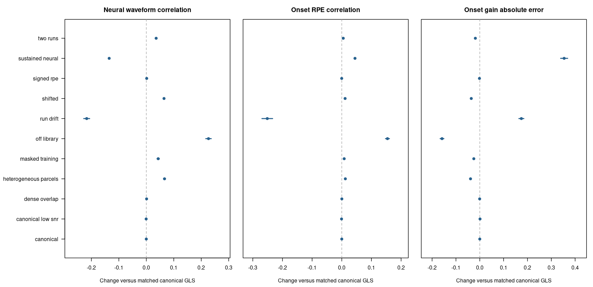

# Noise-aware HRF fitting and recovery diagnostics

This change implements pooled AR(1) noise estimation, stronger evidence for
cross-run HRF selection, and event-schedule diagnostics for amplitude attenuation
and leakage. The continuous neural inverse and fixed-lambda convention remain;
this does not introduce event-constrained neural estimation or automatic amplitude
correction. The existing NIfTI/file wrapper is unchanged.

## User-visible behavior

`estimate_crossrun_hrf()` now defaults to `noise_model = "ar1"` and
`evidence = "calibrated"`. It also applies a small fixed shape-distance penalty
(`canonical_strength = 0.01`) toward `fallback_kernel`. With `hrf_library()`, that
first candidate is canonical; custom libraries must designate their own fallback.
Learning remains optional and a fixed canonical HRF remains the baseline.

A learned departure must have task evidence, evidence against the prespecified
shape, and compatibility with every usable training run. Otherwise the voxel
uses a supported, non-rejected parcel anchor or the prespecified shape. Parcel
anchors need at least `min_parcel_voxels` individually supported voxels for their
shape. Borrowing an anchor does not turn a voxel's own evidence into support.
`min_r2` remains an additional minimum effect-size gate, not a p-value.

Inspect these fields:

- `fit$noise`: run/voxel noise group, coefficient, contributing voxel count, and
  status, including boundary estimates or unidentifiable covariance.
- `fit$selections`: selected task/shape p-values, compatible/supported shape
  counts, evidence, selection/fallback reason, and training-run stability.
- `fit$designs`: whitened design ranks, usable observation counts, and rho strata.
- `fit$training_runs`: explicit target exclusions. With `return_scores = TRUE`,
  `run_evidence` retains the per-run native tests for detailed review.

With AR/calibrated fits, `deconvolve_crossrun_hrf()` now uses the fitted acquisition
mask by default, including during input scaling. Nonfinite censored observations
are allowed; nonfinite observations on retained rows exclude that voxel run.
Latent activity is estimated on the full original time grid. Its
`observation_mask` attribute identifies observed acquisitions: modeled values in
gaps must not be mistaken for measured data during subsequent alignment.
Unidentifiable AR covariance produces explicit missing activity rather than
silently assuming white noise.

Inverse nuisance handling stays explicit: `nuisance_mode = "ignore"` preserves
the existing assumption of consistently prepared BOLD inputs. Optional `"joint"`
fits unpenalized intercept, trend, and supplied nuisance coefficients in the
inverse. Training always jointly fits its own nuisance coefficients. The pilot
found that a free inverse nuisance trend can amplify low-frequency uncertainty
in this very flexible latent model, so joint inverse fitting is not enabled by
default. Do not independently project only the BOLD and assume this equals a
joint task/nuisance model.

To reproduce the original interface's estimation and application choices:

```r
legacy_fit <- estimate_crossrun_hrf(
  bold, events, tr = TR, kernel_grid = candidates,
  noise_model = "ols", evidence = "legacy"
)
legacy_result <- deconvolve_crossrun_hrf(
  bold, legacy_fit, lambda = 0.01,
  nuisance_mode = "ignore", observation_mask = "all"
)
```

The old example, benchmark, and validation scripts explicitly select this legacy
mode so their published comparisons remain reproducible. Their numerical
settings are not silently replaced by new defaults.

## Noise model and computational implementation

For each run, noise estimation uses a fixed event-amplitude mean model based on
the prespecified HRF. When residual degrees of freedom allow, its first two
finite-difference temporal derivatives provide modest protection against HRF
mismatch. Free event amplitudes keep trial variation out of a condition-mean
residual model. At least 10 residual degrees of freedom are required; the richer
derivative model requires 20. Failure is recorded rather than interpreted as
white noise.

Native code evaluates a small AR coefficient grid using restricted likelihood.
It normalizes columns and factors the fixed mean-model subspace once per grid
point, then applies its projections to voxel blocks with BLAS. Likelihood
profiles are averaged within supplied parcels, or the run if no parcels are
provided. This pools covariance information without averaging away signed BOLD
responses. It is a composite estimation criterion; spatially correlated voxels
are not counted as independent observations for an evidence test.

`noise_rho` can instead supply a fixed scalar or named run vector, including zero
for controlled validation. `noise_grid` controls approximation and range; boundary
estimates are reported. This first implementation is AR(1), not an automatic
higher-order/physiological noise model. A parcel with heterogeneous covariance or
mean-model misspecification can still give a poor coefficient.

Whitening uses the original acquisition clock. For observed times separated by
`d` TRs, the transition is `rho^d` and its variance includes the missing
innovations. It does not concatenate retained samples as adjacent acquisitions.
The stationary first-observation factor and gap factors are used identically for
BOLD, nuisance, task designs, and the inverse convolution. The weighting convention
is innovation variance, matching the existing linear inverse's AR convention.
Consequently the numerical lambda still needs an explicit sensitivity analysis
when comparing whitening choices.

The Rcpp inverse uses the exact masked GLS normal equations, the same latent
prehistory and difference penalties as the existing linear inverse, and a fixed
numerical ridge. Optional joint nuisance fitting projects both the convolution
and observations. Operators are shared by HRF/rho/design strata and applied in
voxel blocks; no voxel-specific optimizer, covariance decomposition, or inverse
factorization is added. The bounded cache is cleared when observation masks,
nuisance designs, or run lengths change. R supplies an independent reference.
Scalar Wiener remains available for OLS/all-observation/ignored-nuisance fits; it
explicitly rejects combinations it cannot implement as the same masked GLS.

## Evidence and training-run compatibility

The adjusted partial R-squared score now uses GLS sums of squares. It still ranks
candidate shapes; it is not itself a calibrated probability. New tests are:

1. Task versus nuisance alone, using the added task rank and residual degrees
   of freedom. Independent training-run p-values are Fisher combined, with a
   Bonferroni correction over the HRF library.
2. For each candidate, a pairwise encompassing model containing that candidate
   and the prespecified candidate. Its extra-rank F test asks whether the
   prespecified shape leaves explainable task structure. Tests are Fisher
   combined over runs and corrected over the alternative candidates. A departure
   must also improve the mean score. Subspace-equivalent candidates or unions
   lacking residual degrees of freedom provide no departure evidence.
3. Candidate compatibility within each training run, using encompassing models
   against better-fitting competitors. Corrections cover competitors and usable
   training runs. A candidate strongly rejected by any run is inadmissible; there
   is no averaging away a contradictory run. No common candidate is reported as
   `inconsistent_or_misspecified` / `no_common_library_shape`.

These F tests are exact under the corresponding correct Gaussian mean model and
**known** covariance. Estimated AR covariance, non-Gaussian errors, and missing
mean structure make their calibration approximate. `evidence_alpha = 0.05` is a
per-voxel threshold; it is neither whole-brain correction nor posterior confidence.
Parcel evidence does not multiply p-values across voxels. The penalty toward the
prespecified shape and optional parcel penalty are fixed discrete regularizers,
not an estimated Bayesian hierarchy.

One other run gives no evidence about cross-run consistency. In particular, two
runs with different HRFs can still transfer the wrong shape to each other. Even
agreement among training runs cannot establish stability in the held-out target.
Off-library shapes, neural duration, omitted events, and genuinely varying
vascular responses can all cause rejection or apparent shape differences.
Fallback means inadequate support for adaptation, not absence of neural activity.

## Amplitude and leakage diagnostics

```r
fit <- estimate_crossrun_hrf(
  bold, events, tr = TR, kernel_grid = candidates,
  amplitude_model = "trial", spatial_groups = parcel_ids,
  spatial_strength = 0.02, valid_rows = usable_by_run,
  nuisance = nuisance_by_run
)
result <- deconvolve_crossrun_hrf(bold, fit, lambda = 0.01, scaling = "demean")
onset <- diagnose_crossrun_recovery(result, return_matrices = TRUE)
window <- diagnose_crossrun_recovery(result, lags = seq(-1, 3, by = TR))
onset$summary
onset$events
```

For unit event sources `B`, convolution `H`, frozen inverse `D`, and interpolated
readout `S`, the diagnostic calculates:

```
recovered = S D H B
ideal = S B
amplitude_gain[i] = recovered[i,i] / ideal[i,i]
excess_leakage[i,j] = (recovered[i,j] - ideal[i,j]) / ideal[i,i]
```

The ideal matrix matters: two overlapping neural readout windows can already
share an ideal event source. Reporting all off-diagonal recovered signal as
contamination would confuse that overlap with inverse-induced leakage. Fractional
onsets also mean the ideal onset diagonal need not equal one. Ratios use that
actual reference. Zero ideal diagonals and readouts outside the grid are missing.
Durations use unit-height sources, rather than unit integrated mass.

Per-event output includes gain, mean absolute excess leakage, and leakage from
chronologically previous/next source records. These include other event types,
not just previous feedback trials. Use an explicit run-named `events` subset to
ask about feedback-only sources/readouts. Omitted source types are then outside
the diagnostic; they have not been established to cause no leakage.

`source_kernel_grid` evaluates alternative true-HRF assumptions while leaving
the fitted inverse fixed. The default assumes the fitted shape is true. Neither
choice establishes the actual vascular HRF. Diagnostics include actual masks,
padding, centering, nuisance policy, and regularization. Divisors cancel in these
normalized ratios; estimated scaling, noise, HRF choice, and lambda are held fixed.
They are conditional resolution diagnostics, not confidence intervals or
physiological gain calibration. A scalar correction cannot invert their full
cross-talk matrix, and no correction is applied automatically.
The diagnostic forward model uses acquisition-grid event convolution. It cannot
measure all continuous-time sampling/model errors; the independent continuous
generator in the recovery experiment tests beyond this matched matrix identity.

One operator and matrix product per stratum replaces repeated voxel simulations.
`return_matrices = FALSE` limits returned data to summaries, event records, and
voxel mappings. The event matrix is quadratic in event count, explicitly guarded
by `max_events`; the full voxel count does not multiply diagnostic matrix work.

## Validation and performance

The independent continuous-time generator and original metrics are described in
[HRF_ESTIMATION_VALIDATION.md](HRF_ESTIMATION_VALIDATION.md). The new experiment
compares legacy canonical/learned recovery, canonical GLS, heuristic GLS HRF
selection, and calibrated GLS HRF selection on 40 independent datasets in each
of the same 12 scenarios. It includes all three fixed lambdas (primary 0.01).
Canonical GLS uses exactly the same estimated noise, masks, and inverse nuisance
policy as calibrated GLS, isolating HRF selection from noise handling.

Settings and seeds are saved before simulation. The development pilot used seed
indices 1--3. The reported analysis excludes those datasets and uses indices
4--43, with base 9420000 plus scenario/replicate indices. A three-dataset
continuation supplies indices 41--43. No noise/evidence/lambda setting is selected
using the reported recovery results.
Intervals average over independent multirun datasets, not voxels or shared folds.
The tests cover independent marginal-covariance GLS/F/REML references, nuisance
normal equations, missing-row timing, target exclusion, contradictory training
runs, null behavior, and direct injected-event diagnostic matrices.

Reproduce from the repository root after installation:

```sh
OPENBLAS_NUM_THREADS=1 OMP_NUM_THREADS=1 Rscript --vanilla \
  inst/validation/hrf_noise_recovery.R /tmp/hrf-noise-first 40
OPENBLAS_NUM_THREADS=1 OMP_NUM_THREADS=1 Rscript --vanilla \
  inst/validation/hrf_noise_recovery.R /tmp/hrf-noise-extra 3 \
  canonical,canonical_low_snr,shifted,off_library,signed_rpe,dense_overlap,heterogeneous_parcels,two_runs,run_drift,sustained_neural,masked_training,null 9420040
Rscript --vanilla inst/validation/assemble_hrf_noise_validation.R \
  /tmp/hrf-noise-first /tmp/hrf-noise-extra /tmp/hrf-noise
Rscript --vanilla inst/validation/report_hrf_noise_recovery.R \
  /tmp/hrf-noise inst/validation/noise_results
OPENBLAS_NUM_THREADS=1 OMP_NUM_THREADS=1 Rscript --vanilla \
  inst/benchmarks/hrf_noise.R /tmp/hrf-noise-benchmark 50000 3
```

## Repeated recovery results

The reported experiment contains **480 fresh multirun datasets**, **7,200**
dataset/method/lambda summaries and **20,400** run summaries. Development-pilot
indices are excluded. At the fixed primary lambda 0.01, learned GLS below means
calibrated free-event fitting with spatial strength 0.02 and canonical strength
0.01. Its canonical GLS comparator uses the same estimated covariance and mask.

| Scenario | Canonical GLS neural r | Learned GLS neural r | Change in neural r [95% MC interval] | Change in onset RPE r [95% MC interval] |
| --- | ---: | ---: | ---: | ---: |
| canonical | 0.533 | 0.533 | -0.000 [-0.000, +0.000] | -0.000 [-0.000, +0.000] |
| canonical low snr | 0.253 | 0.253 | -0.000 [-0.001, -0.000] | -0.001 [-0.001, -0.000] |
| shifted | 0.429 | 0.494 | +0.065 [+0.062, +0.067] | +0.011 [+0.010, +0.012] |
| off library | 0.107 | 0.334 | +0.226 [+0.217, +0.236] | +0.154 [+0.147, +0.161] |
| signed rpe | 0.487 | 0.489 | +0.002 [+0.000, +0.003] | -0.000 [-0.001, +0.000] |
| dense overlap | 0.421 | 0.422 | +0.001 [+0.000, +0.002] | +0.000 [+0.000, +0.000] |
| heterogeneous parcels | 0.429 | 0.495 | +0.066 [+0.063, +0.070] | +0.012 [+0.011, +0.014] |
| two runs | 0.425 | 0.461 | +0.036 [+0.033, +0.039] | +0.005 [+0.004, +0.006] |
| run drift | 0.318 | 0.101 | -0.217 [-0.228, -0.206] | -0.251 [-0.269, -0.233] |
| sustained neural | 0.719 | 0.584 | -0.135 [-0.138, -0.132] | +0.045 [+0.042, +0.047] |
| masked training | 0.418 | 0.462 | +0.043 [+0.039, +0.048] | +0.008 [+0.007, +0.009] |



Points and intervals describe independent-dataset Monte Carlo precision under
these generators, not human-population uncertainty. Larger correlation changes
are favorable; smaller gain-error changes are favorable. Null correlations/gains
with true neural activity are undefined and are excluded from this figure.

The main findings are:

- **The evidence gate is much more conservative under noise.** In the null
  scenario, the legacy method accepted every free-event fit and selected a
  noncanonical shape in 97.9% of voxel/fold cases. The new method fell back in
  98.4% and selected a noncanonical shape in 0.21%. Its selected-shape task test
  passed in 1.60%. These are empirical gate/selection frequencies, not downstream
  RPE false-positive rates or a guarantee under other noise models.
- **It largely avoids adapting when the canonical HRF is correct.** Noncanonical
  selections fell from 31.8% to 0.07% in the canonical case and from 94.2% to
  1.08% in the low-SNR canonical case. Recovery stays close to matched canonical
  GLS. Grid REML estimated the generating rho of 0.5 closely: scenario-average
  fitted coefficients ranged from approximately 0.493 to 0.504.
- **Stable mismatch still benefits, at a sensitivity cost.** Shifted-HRF neural
  correlation improved from 0.429 to 0.494 versus matched canonical GLS, and
  off-library recovery from 0.107 to 0.333. The heuristic GLS fits reached 0.529
  and 0.386, respectively: stronger evidence rules deliberately give up some
  sensitivity. Dense-overlap adaptation became especially conservative.
- **Signed-response harm was greatly reduced, rather than replaced by a general
  HRF-learning benefit.** Legacy learned-HRF neural correlation was 0.432; new
  recovery was 0.489, close to matched canonical GLS at 0.487. Onset RPE
  correlations were 0.877, 0.917, and 0.917, respectively. Whitening and avoiding
  unsupported adaptation account for much of this improvement.
- **Amplitude attenuation remains.** In the shifted case, new onset gain was
  0.478 while the -1:+3-s window gain was 0.961. The diagnostic reports this
  distinction and leakage; it does not automatically correct either. Gain
  depends on the event/readout definition and penalty.
- **Two important failures remain.** Two runs with different vascular shapes
  still transfer poorly: learned neural r was 0.101 versus canonical GLS 0.318.
  There is only one training run, so compatibility cannot assess stability.
  With unmodeled 2.5-s neural responses, learning increased onset RPE correlation
  while reducing waveform correlation from 0.719 to 0.584 and increasing onset
  gain from 1.106 to 1.522. These changes do not solve neural-duration ambiguity.
  Strongly contradictory training runs are rejected in a dedicated numerical
  test; that cannot reveal an unseen target-run change.

The masked scenario now removes observations from the inverse as well as HRF
training. The old comparator retained all clean synthetic observations, so the
matched masked GLS comparator is the relevant check for HRF-selection effects.
No contaminated observations, higher-order noise, nonlinear vascular responses,
or participant data were tested in this experiment.

All-method means, intervals, finite counts, and all three lambdas are in
[summary.csv](inst/validation/noise_results/summary.csv); paired changes against
the matching canonical GLS pipeline are in
[paired_vs_matched_canonical.csv](inst/validation/noise_results/paired_vs_matched_canonical.csv).
Raw artifacts and frozen settings are retained at
`/tmp/fmri-hrf-noise/reported/`. Script hashes and seed provenance accompany the
committed tables. A check against the final installed binary reran one dataset
from every scenario and reproduced all 180 method/lambda summaries exactly
(maximum absolute metric difference zero).

## Verification and throughput

An isolated installation passed **56 focused test cases / 892 assertions**,
with no failures, errors, warnings, or skips. The existing linear, voxelwise,
and native NIfTI regressions are included. Rd, parsing, and whitespace checks
also passed. The unrelated full package suite was not run.

R 4.5.1 / OpenBLAS 0.3.30, one BLAS/OpenMP thread, medians of three
repetitions, excluding loading/generation/compilation. Every operation covers
three runs of 300 acquisitions, 50,000 voxels, nine HRFs, and 56 free event
amplitudes per run. Inverse scaling is demeaning.

| Operation | Seconds |
| --- | ---: |
| Original OLS/heuristic HRF fitting on this workload | 4.485 |
| New AR(1)/calibrated HRF fitting | 26.353 |
| New grouped masked-GLS application | 10.343 |
| Onset attenuation/leakage diagnostics | 0.550 |

Noise estimation and evidence tests add work compared with the original model.
The optimized native implementation avoids a second large matrix multiplication
when evaluating REML residual energy. It uses the projection-norm identity and
explicit residuals for near-perfect fits to protect against cancellation. This
reduced the full new fitting workload from **61.567 to 26.353 seconds** on this
host without changing model settings. Independent likelihood checks include a
high-SNR case, and the optimized binary reproduced the 12-scenario recovery
check exactly. Diagnostic cost depends on source-event count, selected shape/
noise strata, masks, and run length, rather than requiring one fit per voxel.

The optimized benchmark can be repeated with the command above, or append
`modern` to time only the new pipeline. The original-mode timings and the new
measurements use the same synthetic inputs; they are different estimators, so
the table is a cost comparison, not an equal-model algorithm speedup. The
before/after projection calculation is an equal-model optimization. Run length,
hardware, system load, event-model rank, and BLAS settings affect throughput.
No voxel subsampling or approximate projections were used.

[Benchmark tables](inst/validation/noise_results/benchmark.csv) and the
[pre-optimization comparison](inst/validation/noise_results/benchmark_before_projection_optimization.csv)
record the measurements. The old standalone benchmark in the HRF guide remains
a historical OLS measurement on different synthetic inputs.
