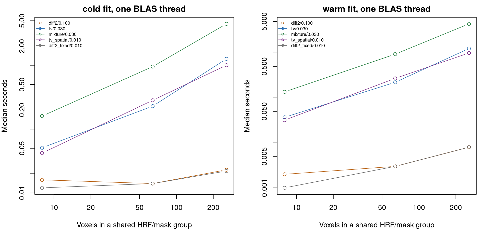

# Continuous neural waveform recovery and event leakage

This study evaluates the output needed for event-aligned analyses: a
continuous neural activity estimate that retains differences between
individual trials. It compares temporal priors before adding a new
production deconvolution API. The implementation is an optimized,
validation-only Rcpp prototype. Existing package defaults, event
alignment, truncation, and censoring policies are unchanged.

## Results and implications

All **160 evaluation datasets / 480 runs / 1,600 method-arm
comparisons** completed and passed frozen-source, seed, completeness,
and diagnostic-record checks. The practical conclusion is to retain the
fast quadratic method while improving and validating HRF/noise
estimation and waveform-oriented tuning. These results do not support
automatically replacing it with an iterative sparse prior in the current
fitted-HRF pipeline.

**The new priors can improve individual-trial recovery when HRF/noise
parameters are known.** For held-out smooth waveforms:

| Method | Neural r, true HRF/rho | Neural r, fitted HRF/rho | Trial-deviation r, true HRF/rho | Trial-deviation r, fitted HRF/rho |
|----|---:|---:|---:|---:|
| Quadratic, lambda .01 reference | .779 | .507 | .750 | .460 |
| Quadratic, development-selected .1 | .815 | .621 | .796 | .610 |
| TV | .847 | .572 | .855 | .554 |
| Transient plus sustained | .849 | .571 | .856 | .554 |
| TV plus spatial | .889 | .541 | .893 | .515 |

Trial-deviation correlation measures differences between individual
trials after removing the average waveform at each lag. Thus the oracle
gains do include preservation of trial variability, rather than only
recovery of a common response.

Relative to the **tuned quadratic** comparator, the mixture reduces
continuous neural NMSE by **.0552** in the true-HRF/rho smooth case
(paired Monte Carlo 95% interval: -.0664 to -.0441) and increases
trial-deviation r by **.0603** (.0512 to .0695). In the fitted-HRF/rho
arm it instead increases NMSE by **.1333** (.1208 to .1458) and reduces
trial-deviation r by **.0566** (-.0653 to -.0478). All fits in this
smooth case converged.

The spatial candidate has the lowest mean continuous NMSE in all eight
oracle scenarios; tuned quadratic has the lowest mean continuous NMSE in
all eight fitted scenarios. Those are rankings of means, not claims of
significant differences in every case or superiority on every metric.
For example, fitted TV preserves brief-trial deviations better than
tuned quadratic (.628 versus .587), despite slightly worse continuous
NMSE (.757 versus .737).

**Better waveform recovery does not guarantee less preceding-source
carryover.** In the smooth case, target-window excess from preceding
responses is .0867 for tuned quadratic and .0678 for TV with true
HRF/rho. With fitted HRF/rho these become .1175 and .1310. Values are
RMS fractions of each voxel’s largest true preceding response. The
weakly penalized .01 reference can have lower excess while recovering
the overall signal less accurately. Read leakage and amplitude error
together, rather than selecting the smallest leakage number alone.


Trial variation and preceding-source leakage

Open markers use true HRF/rho; solid markers use fitted HRF/rho. Error
bars are Monte Carlo intervals over independent datasets, not
uncertainty on a trial.

**The fitted observation model is a major limitation in these
simulations.** The true noise rho is .5. Mean estimated rho is .812 for
smooth waveforms, .879 for biphasic responses, and .900 for sustained
neural overlap. Mean HRF kernel NMSE in those cases is .247, .090, and
.132 respectively. These findings are consistent with unmodeled neural
waveform structure entering the noise/HRF fit, but the combined fitted
arm cannot identify how much loss each component causes. HRF fallback
rates are also retained; they range from 2.1% in sustained overlap to
37.1% in spatial heterogeneity. This is not evidence against all HRF
estimation strategies.

**Genuine neural overlap must survive reconstruction.** In that
scenario, the true preceding contribution during target lags 0–3 has
mean RMS .842 of its peak. Oracle TV recovers .834, rather than forcing
it toward zero. Its excess error is measured relative to that real
ongoing activity. The examples below are the prespecified first
replicate and first voxel, not selected examples.


Silent targets with ended versus continuing preceding activity

There are **37 iteration-limit voxel fits among 76,800**: one oracle
block-TV fit, 20 oracle overlap-TV fits, and 16 oracle overlap-mixture
fits. These affect 13 of 20 overlap datasets for TV and 12 for the
mixture, so the small global failure fraction must not hide the
concentration in this stress case. Strict convergence-only overlap
comparisons retain only 7 and 8 datasets, respectively; the numerical
limitation matters for deployment. The remaining fits, including all
fitted-HRF/rho fits, converged. Primary results retain all datasets and
expose these flags; convergence-only comparisons are supplementary.

The next production-oriented steps supported by this study are:

1.  **Isolate HRF and covariance errors:** cross true/fitted HRF with
    true/fitted rho, then test a training mean model that can represent
    variable-duration neural activity. Independent HRF calibration or
    explicit physiological shape constraints should also be tested.
    Avoid changing both and attributing a gain or loss to HRF fitting
    alone.
2.  **Keep waveform and trial-variation diagnostics in tuning
    decisions.** Stronger quadratic regularization materially improves
    this study’s waveform loss, but its truth-based lambda selection
    does not transfer automatically to participant data. A BOLD
    prediction score alone is not validation of recovered neural timing.
3.  **Keep TV/spatial candidates experimental until the fitted-model gap
    and speed cost are addressed.** The activity-prior comparison uses
    different selected temporal lambdas (.01 spatial versus .03
    nonspatial). Its gains cannot be attributed exclusively to spatial
    borrowing without a matched-lambda ablation. The opposite-sign
    scenario does not collapse here, but it does not establish that
    general spatial smoothing is harmless.
4.  **Optimize the solver structure before whole-brain adoption.** The
    current native dense updates already batch signals and reuse
    factors, yet remain much slower than quadratic inversion. Banded
    convolution/penalty solves with low-rank nuisance adjustments,
    followed by verified stopping-parameter tuning, are more useful next
    targets than simply adding more workers.

The fixed .01 comparator is the preceding studies’ reference, not a
universal package lambda default. No new automatic gain correction,
event attribution, truncation threshold, or censoring recommendation
follows from this experiment.

## What is estimated

All methods reconstruct the entire acquisition before extracting any
epochs. Neither event onsets nor RPE values enter the neural solver.
Each time point has its own latent activity value; no event-type mean
response is fitted. Events enter only the cross-run HRF estimator and
the subsequent simulation scoring. The HRF estimator has free amplitudes
for individual events, with no RPE regressor.

There are two distinct outputs one could want:

1.  **Activity present around an event.** This continuous reconstruction
    includes activity that genuinely persists from an earlier event, as
    a neural recording would. This study evaluates this output.
2.  **Activity exclusively attributable to that event.** Separate
    flexible trial waveforms can exchange activity wherever their
    supports overlap without changing the summed neural signal or BOLD.
    This study includes an explicit nonidentifiability test. It does not
    claim to identify that decomposition.

The target is slow population activity, not the voltage waveform or
frequency content of an LFP. TR remains one second throughout; no
upsampling is used to claim finer temporal resolution.

## Candidates and shared observation model

Let `A` be the finite HRF convolution after selecting usable acquisition
rows, gap-aware AR(1) whitening, and projection of an intercept and
linear drift. `Y` is standardized BOLD after the same transformation.
All candidates include 32 pre-run latent samples and the same small
numerical ridge (`1e-8`). There are no artificial post-run observations.

| Method | Objective, omitting the shared numerical ridge |
|----|----|
| Fixed quadratic reference | `0.5 ||A X - Y||² + 0.5 * .01 ||D2 X||²` |
| Tuned quadratic | Same objective, development-selected lambda |
| TV | `0.5 ||A X - Y||² + lambda ||D1 X||1` |
| Transient plus sustained | `X = U + V`; `0.5 ||A(U+V)-Y||² + lambda (||U||1 + ||D1 V||1)` |
| TV plus spatial | TV objective plus `0.5 * .01 * trace(X L X')` |

TV favors sparse changes rather than smooth curvature. The mixture can
place brief activity in `U` and sustained activity in `V`. Both
components are signed; their decomposition itself is not a physiological
identification. Only their sum is evaluated as the recovered neural
series. This is a candidate model inspired by sparse deconvolution, not
a reimplementation of Total Activation.

For the spatial candidate, `L = I - 11'/m` within a supplied parcel and
identical HRF/noise group. It shrinks activity toward the parcel mean in
standardized units. It does not enforce equal waveforms. Parcel
membership is supplied before seeing activity; opposite signs are never
regrouped to help the prior. The heterogeneity scenario deliberately
violates the assumption of coherent signs. The spatial strength is a
single fixed test value, not a search over spatial priors. This is a
prior on neural activity, distinct from the existing HRF-shape
regularization. The latter is held fixed across the learned-HRF
comparisons.

BOLD standardization uses each voxel’s SD on usable observations.
Recovered activity is multiplied by that SD to restore input units. This
makes the L1 penalties insensitive to an arbitrary change of BOLD units.
For each paired counterfactual, the observed dataset’s SD is frozen so
changes in normalization cannot masquerade as temporal leakage. Native
factors are shared across signals with the same HRF, mask, and
covariance.

## Simulation and separation of tuning from evaluation

The independent forward generator evaluates neural waveforms and
gamma-density HRFs on a 0.1-second grid, numerically convolves them
using an FFT, and samples BOLD at one-second intervals. It does not call
package HRF, event-design, or convolution routines. The inverse operates
only on the acquisition grid. The small discrepancy between continuous
forward generation and sampled HRF kernels is retained, including in the
oracle-HRF reference.

Each dataset contains three independent 256-volume runs and eight voxels
in two supplied parcels. The positive-gamma HRF shape parameters are 5
and 7 in the ordinary cases (positive peaks approximately 4 and 6
seconds). Each run has five pairs of events. A large preceding response
is followed after 3, 6, or 10 seconds by a target; three of the five
targets are genuinely null. The gaps rotate across runs. Active targets
have an RPE effect and additional trial-specific amplitude variation.
Latencies, durations, and amplitudes vary across trials and voxels. A
low-amplitude continuous background and an unmarked event are included
in neural truth. Measurement noise is AR(1), with marginal SD .04, rho
.5, and shared plus voxel-specific components.

| Scenario | Purpose |
|----|----|
| Brief blocks | Large short response followed by a silent target; also used for development |
| Longer blocks | Sustained responses; also used for development |
| Smooth, held out | Compact smooth pulses with varying widths and latencies |
| Biphasic, held out | Positive and negative lobes; tests shape and sign assumptions |
| Neural overlap | Preceding activity truly lasts 11–14 seconds; it must be retained |
| HRF mismatch | Smooth neural pulses, gamma shape parameters 4.3/8.3 absent from the fitted grid |
| Censored, held out | Several missing blocks on the original clock |
| Spatial heterogeneity | Opposite response signs within the supplied parcels |

Development uses four independent datasets in each of the first two
scenarios. Each temporal method searches four lambdas:
`.001, .01, .1, 1` for quadratic; `.003, .01, .03, .1` for TV and the
mixture. A candidate must converge for every voxel in both the observed
and paired counterfactual fits to be eligible. Selection minimizes mean
continuous neural NMSE over development datasets. The existing quadratic
lambda `.01` is kept as a separate reference.

Evaluation uses 20 fresh datasets per scenario, including entirely
held-out waveform families. Settings are frozen before generating
evaluation data. Development seeds are
`24000000 + scenario_index*10000 + replicate`; evaluation seeds use
`26000000` instead. The full study has 160 independent evaluation
datasets and 480 runs. Voxels, trials, and runs are not treated as
independent replicates for Monte Carlo intervals. Development tuning
uses known simulated neural truth. It is not a new tuning procedure
available for participant data, and the selected lambdas should not be
interpreted as universal recommended settings.

Each evaluation is performed twice:

- **Oracle HRF and rho:** isolates neural reconstruction from HRF/noise
  estimation.
- **Cross-run estimated HRF and rho:** uses the existing package
  estimator; each run’s HRF selection uses the other two runs. The
  supplied events are modeled as impulses with free trial amplitudes.
  The estimator is not supplied the true neural durations or shapes. Its
  resulting shape/latency ambiguity is deliberately part of this more
  difficult evaluation.

The tuning chosen in the oracle-HRF development arm is retained in both
arms. This is a controlled transfer test, not an optimally tuned
learned-HRF pipeline. The learned arm changes both HRF shape and noise
covariance. A performance gap against the oracle therefore cannot be
attributed solely to HRF estimation. Its impulse-based HRF training
model is intentionally challenged by sustained neural truth; a poor
result would not establish that all HRF estimation fails. Kernel error,
estimated rho, rho error, and fallback rates are retained to help
identify what needs a subsequent controlled comparison.

## Waveform and leakage diagnostics

Scores use the interior of each run, excluding the first 32 and last 33
samples. Censored observations remain at their original positions and
are omitted from scoring. A predicted latent sample in a gap is not an
observation. Epochs span -2 through +14 seconds from the target, using
linear interpolation for fractional onsets. Scoring an interpolated
point conservatively requires both bracketing acquisition rows to be
usable. No trial is discarded simply because it overlaps.

Because nuisance projection removes information about the neural DC
level, evaluation aligns one constant offset per voxel using its
interior truth. This is an explicitly oracle evaluation adjustment,
never an available user operation. It does not align latency, rescale
amplitudes, or adjust individual trials. Unaligned continuous NMSE is
retained alongside the adjusted measure. An absolute physiological
neural baseline remains unidentified.

Measures include:

- Continuous neural correlation and NMSE.
- Correlation and NMSE of each actual event-aligned waveform.
- Correlation and NMSE of trial departures from the average waveform:
  subtract the across-trial mean separately at each lag before comparing
  estimates and truth.
- Absolute errors in peak magnitude, signed area, peak latency, and
  effective width (`sum(abs(activity))/max(abs(activity))`). These
  describe the continuous activity in the epoch, which can include
  multiple events; they are not estimates of an isolated target’s
  physiological duration. Censored epochs use their common retained
  bins.
- Error in null-target windows and paired preceding-source leakage by
  spacing.

The leakage test reconstructs two signals with identical target
responses, background, measurement noise, and censoring. In the second
signal, **all preceding-event responses are removed**. The HRF, rho, and
BOLD scaling remain frozen from the original data. If `F` is
reconstruction, the diagnostic is:

    estimated preceding contribution = F(Y) - F(Y_without_previous)
    excess = estimated preceding contribution - true preceding neural activity

Excess RMS is scored during target lags 0–3 and divided by the voxel’s
largest true preceding-response magnitude. In the short-response case,
true activity from the preceding event has ended, so this measures
spurious carryover. In the neural-overlap case, the correct preceding
contribution is nonzero: removing it would be an error. True and
recovered preceding activity are both reported. Null-target error also
measures the absolute reconstruction error around silent targets,
including background recovery and noise.

These paired differences are conditional on context and on removing the
entire set of preceding responses. For nonlinear penalties, they are not
additive single-event contributions or an invertible linear resolution
matrix.

An additional perturbation experiment injects a single neural impulse at
each of nine source lags and measures the full recovered time course. It
repeats this for amplitudes .25 and 1 in quiet and noisy backgrounds,
holding scaling fixed. The saved maps show temporal spreading and
context/amplitude dependence; they are not posterior uncertainty or
evidence of sub-TR resolution. The spatial candidate has only one voxel
in this experiment, so its Laplacian is zero; that curve tests its
temporal lambda, not spatial borrowing.

All 180 perturbations converged with a probe-only cap of 60,000
iterations. The quiet-background TV and mixture probes needed
substantially more iterations than the primary study’s 12,000 cap. This
is a numerical stress result, not a reason to silently increase the
primary evaluation’s iteration budget.


Conditional temporal perturbations

Sharper-looking responses are not necessarily accurate. These
conditional maps can change shape with background noise and injected
amplitude; negative lobes and shifted peaks can appear before the
injected impulse. A gain correction at one lag cannot undo this full
temporal behavior.

## Numerical verification and speed

The prototype uses batched native ADMM with exact common quadratic
updates. Both primal and dual residual criteria must pass for every
voxel; iteration-limit failures remain explicit. The fixed ADMM rho is
.01, the iteration limit is 12,000, absolute tolerance is `1e-6`, and
relative tolerance is `1e-5`. The quadratic candidate is solved
directly.

Preparation is cached across paired fits and penalty thresholds.
Temporal differences and their adjoints are applied directly. Without
spatial coupling, the solver uses a shared inverse application without
voxel rotations. For the parcel Laplacian, the native implementation
solves its shared mean and residual subspaces directly, avoiding
repeated dense voxel rotations. A generic eigendecomposition fallback
supports other positive-semidefinite inputs.

Tests compare native TV, mixture, and spatial solutions with an
independent R implementation using explicit matrices and fresh linear
solves. Other checks cover the package quadratic inverse, independent
forward quadrature, causal alignment, acquisition-clock censoring, scale
equivariance, convergence failure, true neural overlap, trial variation
metrics, and nonidentifiable event decompositions. Collection checks
reject missing/duplicate metrics, missing solver records, incorrect
seeds, incompatible shards, and changes to frozen sources. The completed
focused suite passed **86 cases / 1,147 assertions**, with no failures,
errors, warnings, or skips. It includes the existing cross-run HRF,
quadratic deconvolution, voxel extraction/alignment, and earlier
recovery studies.

The separate benchmark measures cold preparation plus fitting and cached
fitting at 8, 64, and 256 voxels, with one HRF/mask group and one
BLAS/OpenMP thread. Compilation is excluded. This remains a dense
validation prototype, not a whole-brain implementation or a 50,000-voxel
speed claim.

In the completed benchmark, all 90 fits converged. Median times at 256
voxels and 256 volumes on an AMD EPYC 7313, using one BLAS/OpenMP
thread, were:

| Candidate                | Cold fit, seconds | Cached fit, seconds |
|--------------------------|------------------:|--------------------:|
| Quadratic, lambda .01    |             0.022 |               0.008 |
| Quadratic, lambda .1     |             0.023 |               0.008 |
| TV                       |             1.262 |               1.246 |
| Transient plus sustained |             4.464 |               4.412 |
| TV plus spatial          |             1.004 |               0.994 |

The iterative priors remain much slower despite native batching and
caching. These final timings were collected after the evaluation workers
finished. Three repetitions on a shared 64-logical-CPU host still
describe local timings, rather than isolated hardware throughput or a
precise scaling law.



Runtime by voxel count

## Limits of the comparison

The pairs intentionally isolate a large preceding response and silent or
active target. They are separated by 40 seconds; this is not a dense
realistic task schedule with cue, action, feedback, and many recent
events. Only one TR, one measurement-noise level/covariance family,
eight voxels, and fixed-within-voxel HRFs are tested. Longer neural
responses also produce more BOLD signal, so differences between waveform
families are not pure shape effects at matched SNR.

The lambda search is deliberately small. The mixture’s two L1 weights
are equal; the spatial prior has one fixed strength. This does not
exhaust sparse priors, mixture weights, signed L1 alone, higher-order
TV, HRF models, or optimized iterative solvers. Bush/Cisler and
nonlinear positivity-constrained methods are not re-evaluated here. No
participant dataset, neural recording, physiological noise model,
nonlinear vascular response, or changing HRF is included.

Primary accuracy summaries retain all prespecified datasets, including
flagged iteration-limit fits. Separate paired comparisons restricted to
datasets where both methods fully converged show the numerical
sensitivity; their smaller sample sizes are explicit and they do not
replace the primary results. Monte Carlo intervals describe mean
performance across independent simulated datasets, not uncertainty on an
individual’s trial waveform.

Low preceding-source leakage can also result from suppressing neural
responses. It must be read alongside waveform/NMSE, trial-variation
recovery, and amplitude errors. These simulations do not establish a
universal safe inter-event interval or justify automatically truncating
a fixed number of seconds from user data.

## Reproduction and outputs

Use the package checkout containing the cross-run HRF/noise estimator.
Set `FMRI_VALIDATION_LIBRARY` if that version is installed in a separate
library. Run from the repository root with one BLAS/OpenMP thread:

``` bash
export OPENBLAS_NUM_THREADS=1 OMP_NUM_THREADS=1
Rscript --vanilla inst/validation/run_waveform_recovery.R /tmp/wv-development development 4
Rscript --vanilla inst/validation/run_waveform_recovery.R /tmp/wv-evaluation evaluation 20 '' /tmp/wv-development/selection.rds
Rscript --vanilla inst/validation/report_waveform_recovery.R /tmp/wv-evaluation /tmp/wv-report
Rscript --vanilla inst/validation/diagnose_waveform_recovery.R probe /tmp/wv-development/selection.rds /tmp/wv-report
Rscript --vanilla inst/validation/diagnose_waveform_recovery.R benchmark /tmp/wv-development/selection.rds /tmp/wv-report
```

For parallel scenario shards, replace the empty fourth argument with a
comma-separated scenario list and use separate empty output directories.
Keep the same selection file, seed scheme, and sources. Give the report
their common parent directory. Independent R processes share the
compiled solver cache but do not alter package installations. No
existing output directory is overwritten by the simulation runner.

`resume_waveform_recovery.R STOPPED_SHARD SCENARIO NEW_DIRECTORY [WORKERS]`
retains completed datasets and computes only missing seeds into a new
directory. Stop the source process first. Its unchanged frozen protocol
is verified by the final collector. Optional Linux fork workers generate
exactly the same explicitly seeded datasets; serial and parallel
recovery metrics, leakage, and solver diagnostics are tested for bitwise
equality. Each worker uses one BLAS/OpenMP thread. Development shards
can be combined and frozen with `freeze_waveform_development()` from the
report script; both brief and block scenarios must be complete before
evaluation begins.

`inst/validation/waveform_results/` contains the frozen
selection/development record, dataset metrics, Monte Carlo intervals,
paired comparisons, spacing diagnostics, solver and HRF diagnostics,
fixed-first-replicate examples, perturbation maps, runtime measurements,
and provenance/checksums.

Methodological references: [Total
Activation](https://pubmed.ncbi.nlm.nih.gov/23384519/) motivates testing
sparse temporal changes and spatial coherence; [Boyd et al.’s ADMM
paper](https://web.stanford.edu/~boyd/papers/admm_distr_stats.html)
provides the splitting and primal/dual stopping framework. Neither
establishes that these candidate penalties recover contamination-free
individual trials.
